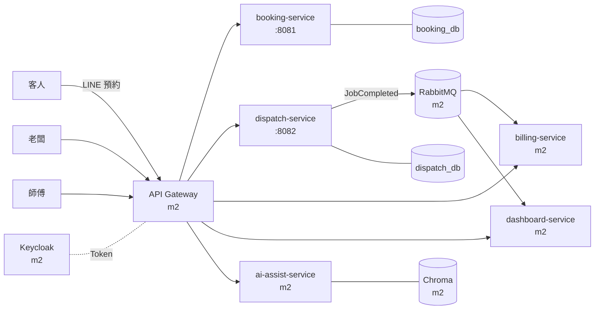
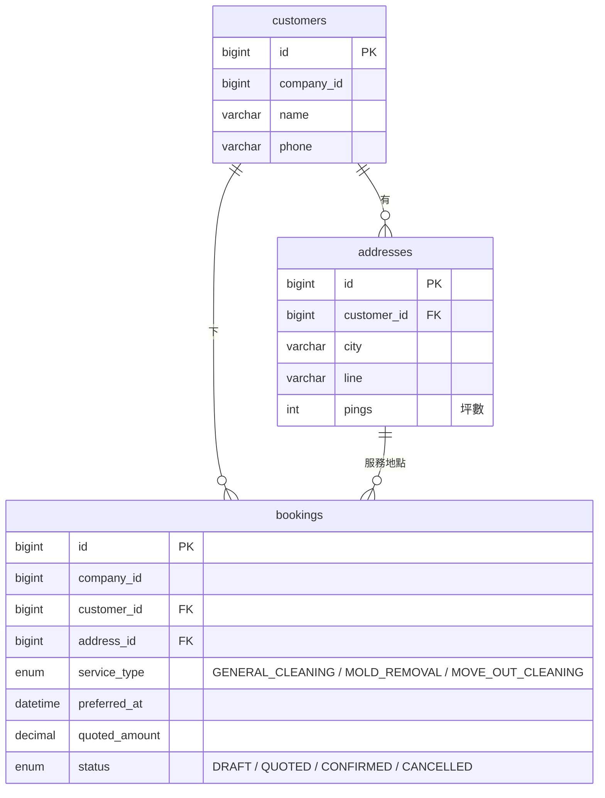
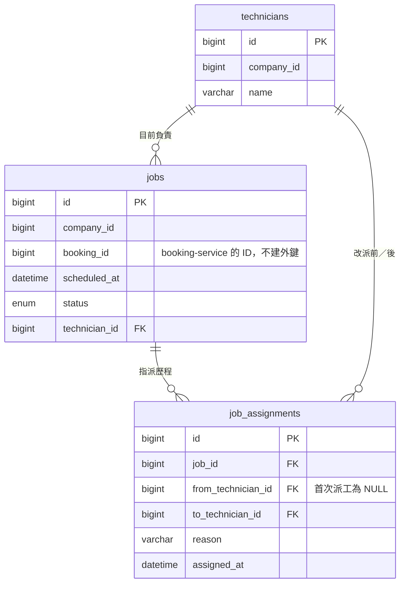

# 架構決策文件 v1：一九姨管家（居家清潔派工平台）

學員：王彥皓　｜　里程碑：m1　｜　版本：v1（2026-11-26）

## 1. 系統情境

一九姨管家是實際營運中的居家清潔與防霉派工系統：客人透過 LINE 預約，清潔公司老闆派工給師傅，師傅到府施工、回報完工，最後收款。現行版本是 Cloudflare Worker + JavaScript；本專題以 Spring Boot 微服務從零重寫，沿用業務規則與狀態定義，不搬任何原有程式碼。

角色：平台管理員、清潔公司老闆、師傅、客人。多租戶：一個平台多家清潔公司，每家只看得到自己的資料（所有資料表帶 `company_id`）。



## 2. 服務拆分與理由

| 服務 | 職責 | 自己的資料 | 里程碑 |
|---|---|---|---|
| booking-service | 客戶、地址、預約、報價 | booking_db | **m1** |
| dispatch-service | 派工單生命週期、指派與改派歷程 | dispatch_db | **m1** |
| billing-service | 完工開帳、收款、對帳 | billing_db | m2 |
| dashboard-service | CQRS 查詢端：師傅負載、月營收、逾期未收 | 查詢 DB | m2 |
| ai-assist-service | 預約訊息擷取、知識庫問答、對話式改派 | Chroma | m2 |

拆分依據：
- **負責的人不同**：預約是客服、施工是師傅、收款是會計，三段流程的使用者與權限不同。
- **變動頻率不同**：收款規則（折扣、分期、發票）改的頻率遠高於派工流程，改帳務不應連派工一起重新部署。
- **失敗隔離**：開帳失敗不能讓師傅卡在結案畫面，所以派工到帳務走非同步事件。

**Database per Service**：每個服務只連自己的資料庫帳號，`booking` 帳號只有 `booking_db` 權限、`dispatch` 帳號只有 `dispatch_db` 權限（見 `db/init/01-databases.sh`）。m1 為節省本機資源，兩個資料庫放在同一個 MySQL 容器內，以帳號權限隔離；跨服務一律只存對方 ID，不建外鍵（例：`jobs.booking_id`）。

## 3. ER 圖

### booking_db



### dispatch_db



派工單狀態：`PENDING`（待派）→ `ASSIGNED`（已派）→ `IN_PROGRESS`（施工中）→ `AWAITING_ACCEPTANCE`（待驗收）→ `COMPLETED`（完成）；任何未完成狀態可轉 `CANCELLED`。改派一律寫一筆 `job_assignments`，且只能指派給同公司的師傅（`Job.assignTo` 檢查，見 `JobRepositoryTest`）。

## 4. API 草案

m1 已實作（唯讀）：

| 服務 | 方法 | 路徑 | 說明 |
|---|---|---|---|
| booking | GET | `/actuator/health` | 健康檢查（含 DB） |
| booking | GET | `/api/companies/{companyId}/customers` | 某公司的客戶 |
| booking | GET | `/api/customers/{customerId}/bookings` | 某客戶的預約 |
| dispatch | GET | `/actuator/health` | 健康檢查（含 DB） |
| dispatch | GET | `/api/companies/{companyId}/jobs` | 某公司的派工單 |
| dispatch | GET | `/api/jobs/{jobId}/assignments` | 派工單的指派／改派歷程 |

m2 規劃：

| 服務 | 方法 | 路徑 | 說明 |
|---|---|---|---|
| booking | POST | `/api/bookings` | 建立預約（Bean Validation：坪數 > 0、時段不早於現在） |
| booking | POST | `/api/bookings/{id}/quote` | 報價 |
| dispatch | POST | `/api/jobs/{id}/assign` | 指派／改派（同公司檢查） |
| dispatch | POST | `/api/jobs/{id}/complete` | 完工，發出 `JobCompleted` 事件 |
| billing | GET | `/api/invoices?status=UNPAID` | 未收帳款 |
| ai-assist | POST | `/api/ai/booking-draft` | LINE 訊息 → `BookingDraft`（Structured Output） |
| ai-assist | POST | `/api/ai/ask` | 客服知識庫 RAG，回答附來源 |

companyId 在 m2 改由 Keycloak Token 取得，不再從路徑帶入，防止水平越權。

## 5. 選用的微服務模式

| 模式 | 用在哪 | 理由 |
|---|---|---|
| RabbitMQ 非同步 | dispatch 發 `JobCompleted` → billing 開帳、通知推 LINE | 開帳失敗不應擋住師傅結案；消費失敗重試 3 次後進 DLQ |
| CQRS | dashboard-service 用事件同步出去正規化查詢模型 | 老闆儀表板要同時看派工與帳務，不能跨服務 join |
| API Gateway | Spring Cloud Gateway 統一入口 | 驗 Token、限流、路由 |
| 斷路器 | 呼叫 ai-assist 時（Resilience4j） | AI 逾時或失敗改走人工填單，不讓整個請求失敗 |
| 服務發現 | Docker Compose 服務名稱 DNS（`mysql`、`booking-service`） | 部署 A 只有單機 Compose，DNS 已足夠；不另架 Eureka，減少一個要維運的元件 |
| Database per Service | 每服務獨立 DB 帳號 | 服務之間只透過 API／事件溝通 |
| 授權 | Keycloak（Authorization Server）＋各服務 Resource Server；服務間 Client Credentials；Google 第三方登入 | 課程共同必做 |

## 6. m1 驗收方式

```bash
git clone https://github.com/balianqbar-eng/191HK-microservices.git
cd 191HK-microservices
docker compose up -d --build
curl -i http://localhost:8081/actuator/health   # 200 {"status":"UP"...}
curl -i http://localhost:8082/actuator/health   # 200 {"status":"UP"...}
curl http://localhost:8082/api/jobs/1/assignments   # 測試資料：阿明 → 阿華 改派歷程
```

資料存在 Docker Volume `mysql-data`，`docker compose down` 後再 `up` 資料仍在；`docker compose down -v` 才會清除。
